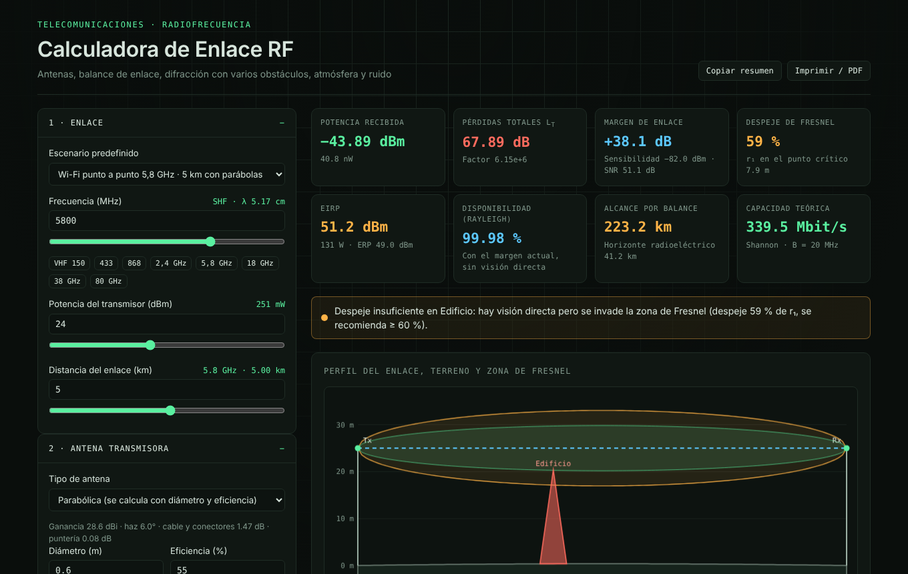

# Calculadora de Enlace RF

Simulador interactivo de enlaces de radiofrecuencia: balance de enlace, antenas, difracción con varios obstáculos, zona de Fresnel, atmósfera, ruido y exposición a RF. Funciona en el navegador, sin instalar nada.

🔗 **Demo:** https://TU-USUARIO.github.io/calculadora-enlace-rf/

## Qué calcula

| Bloque | Contenido |
|---|---|
| Espacio libre | Densidad de flujo de potencia, apertura equivalente, pérdida básica Lbf (con verificación por fórmula práctica) |
| Antenas | Catálogo de 19 tipos (dipolo, monopolo, omni, Yagi, log-periódica, parche, panel, sectores, helicoidal, bocinas), parabólica por diámetro y eficiencia, antena personalizada en dBi o dBd |
| Acoplamiento | Cables de bajada (RG-58 a Heliax 1-5/8"), conectores, polarización cruzada o circular, error de puntería |
| Obstáculos | Cantidad ilimitada, con posición, altura y radio de curvatura. Métodos de difracción: obstáculo dominante, Bullington, Epstein–Peterson y Deygout, comparados en una tabla |
| Terreno | Perfil pegado como texto (km y altura), curvatura terrestre con factor k, altura mínima de torres para 60 % de despeje |
| Suelo | Reflexión con modelo de dos rayos y 5 tipos de suelo |
| Entorno | Absorción de gases, lluvia, vegetación y penetración de 8 materiales de construcción |
| Receptor | Piso de ruido, figura de ruido, SNR mínima, margen de enlace, capacidad de Shannon, disponibilidad por desvanecimiento Rayleigh |
| Seguridad | EIRP y distancia mínima según niveles de referencia ICNIRP |

Incluye 5 escenarios de ejemplo (el caso base de 300 MHz y 10 km, Wi-Fi 5,8 GHz, radioenlace de 18 GHz con lluvia, VHF con loma y vegetación, LoRa urbano).

## Caso base de referencia

Con 100 W (50 dBm), 300 MHz, 10 km, antenas de 10 dBi y una atenuación de campo ae = 4:

- Pérdida básica: **101,98 dB**
- Pérdidas totales: **88,00 dB**
- Potencia recibida: **−38 dBm (≈ 158 nW)**
- Primera zona de Fresnel en el punto medio: **50 m** (60 %: 30 m)

## Qué modela y qué no

Son modelos aproximados con fines educativos:

- Difracción según ITU-R P.526, gases según una forma simplificada de P.676 (hasta unos 100 GHz), lluvia según P.838 con el factor de distancia de P.530, vegetación de Weissberger y reflexión en suelo con coeficientes de Fresnel.
- La curvatura terrestre se trata como un perfil de obstáculos con factor k, no como difracción por tierra esférica.
- **No incluye** multitrayecto ni desvanecimiento selectivo, conductos troposféricos, dispersión troposférica, interferencia entre canales ni pérdidas por desadaptación (ROE).
- Las ganancias del catálogo son valores típicos y no varían con la frecuencia. Las pérdidas de cables y materiales son orientativas: confirmá con la hoja de datos del fabricante.

**No reemplaza un estudio de radioenlace profesional.**

## Cómo usarlo

Abrí la demo, o descargá `index.html` y abrilo en cualquier navegador. Es un único archivo sin dependencias de código externas (solo carga tipografías de Google Fonts, y funciona igual sin ellas).

## Cómo se hizo

Lo armé como parte de mi aprendizaje en telecomunicaciones, con ayuda de herramientas de IA (Claude y Gemini) para escribir el código. Los problemas de base los resolví paso a paso a mano y usé esos resultados para comprobar que el simulador da los mismos valores.

## Licencia

MIT. Ver [LICENSE](LICENSE).

---

**Stefanel Montenegro** · [LinkedIn](https://linkedin.com/in/stefanel-montenegro-06860a245)
